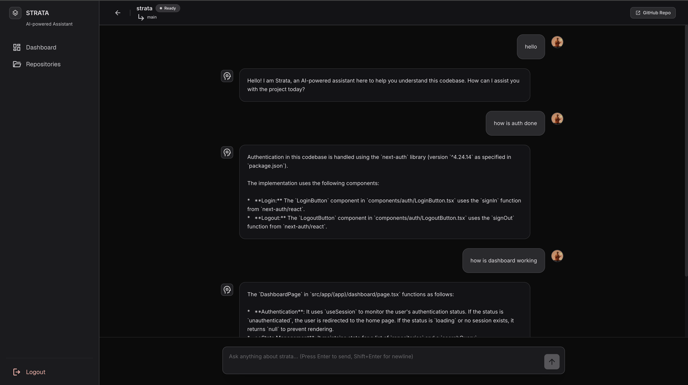
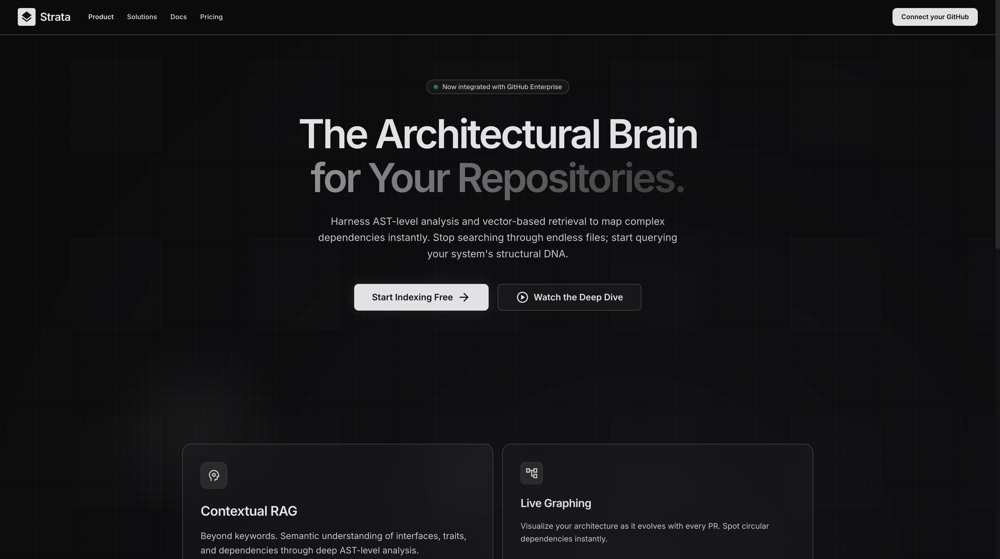
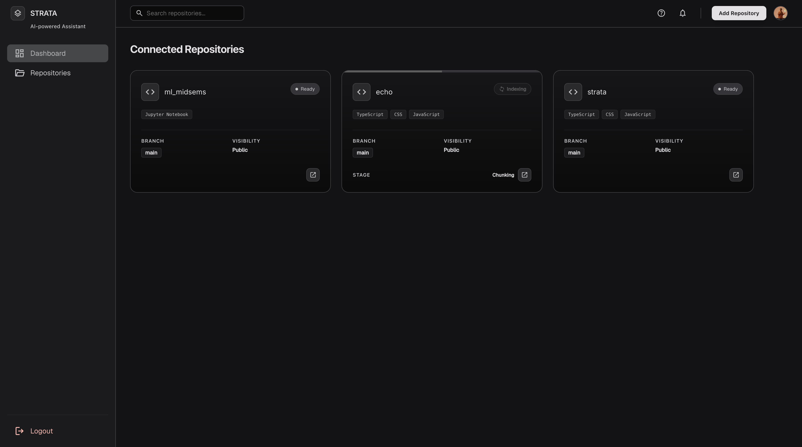
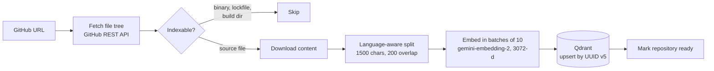
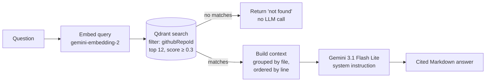
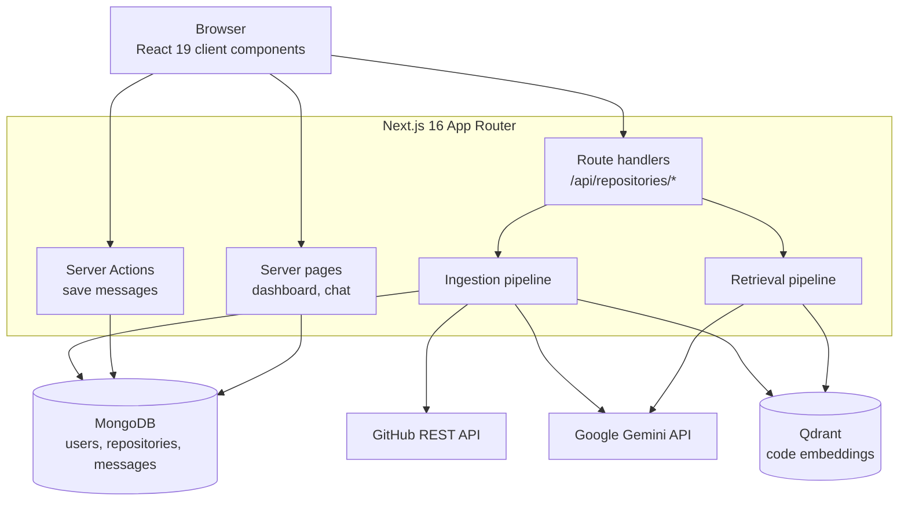
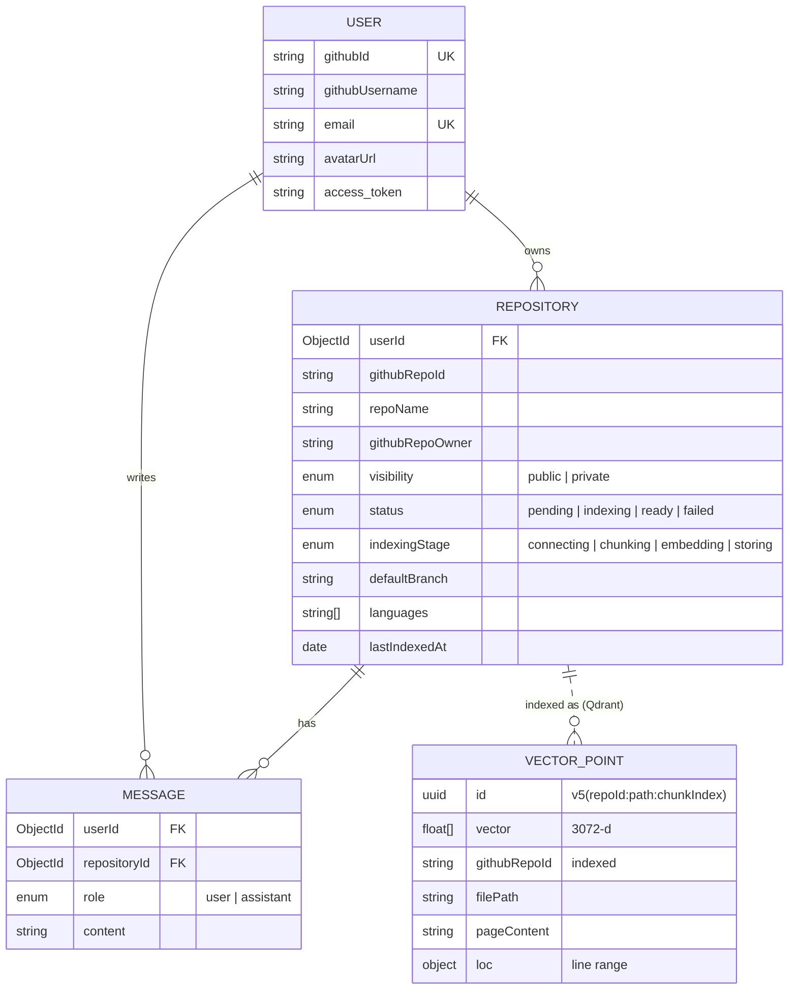

<div align="center">

# Strata

**Ask your codebase anything. Get answers with file and line citations.**

Strata indexes a GitHub repository into a vector database and answers natural-language questions about it with retrieval-augmented generation (RAG). Every answer is grounded in your source code and points to the exact lines it came from.

[](https://nextjs.org/)
[](https://react.dev/)
[](https://www.typescriptlang.org/)
[](https://ai.google.dev/)
[](https://qdrant.tech/)
[](https://mongoosejs.com/)

[How it works](#how-it-works) · [Quick start](#quick-start) · [Architecture](#architecture) · [API](#api-reference) · [Design decisions](#design-decisions) · [Limitations](#known-limitations) · [Roadmap](#roadmap)



</div>

---

## Why Strata

Joining a new codebase is slow. You trace one request across a dozen files, `grep` for `auth` and miss `authOptions`, `getToken` and `proxy.ts`, and end up asking a senior engineer questions the code could have answered.

Strata turns the repository into something you can talk to:

- **Semantic, not lexical.** Questions are matched by meaning, so "where do we check if a user is logged in?" finds the session code even when none of those words appear in it.
- **Grounded answers.** The model is told to answer only from retrieved code. When the code is not there, it says what is missing instead of guessing.
- **Cited to the line.** Answers reference sources as `src/lib/dbConnect.ts:L8-L20`, so every claim can be checked.
- **Private repos work.** Strata reads code through your GitHub OAuth token, so it can index any repository you can access.

## Features

| | |
| :--- | :--- |
| **GitHub sign-in** | One-click OAuth via NextAuth. Your token is used to read repositories you have access to. |
| **Repository indexing** | Paste a GitHub URL. Strata fetches the file tree, filters out binaries, lockfiles and build output, chunks the code and stores embeddings. |
| **Live indexing status** | Each repository moves through `pending` → `indexing` → `ready` / `failed`, with a visible stage: `connecting`, `chunking`, `embedding`, `storing`. |
| **Retry on failure** | A failed index can be re-run from the dashboard. Deterministic vector IDs make re-runs overwrite rather than duplicate. |
| **Language-aware chunking** | Code is split along language boundaries (functions, classes, blocks) for JS/TS, Python, Go, Rust, Java, C/C++, Ruby, PHP, Swift, Scala, HTML, Markdown and more. |
| **Cited, formatted answers** | Responses render as Markdown (lists, tables, code blocks) with inline `file:line` citations. |
| **Persistent chat history** | Every question and answer is saved per repository. |
| **Chat gated on readiness** | The input stays locked until the repository index is `ready`. |

<table>
  <tr>
    <td></td>
    <td></td>
  </tr>
  <tr>
    <td align="center"><sub>Landing page</sub></td>
    <td align="center"><sub>Repository dashboard with indexing status</sub></td>
  </tr>
</table>

## How it works

Strata has two pipelines: one that **indexes** a repository once, and one that **answers** each question.

### 1. Indexing



1. **Connect.** The repository record is created in MongoDB as `pending`, and the API responds immediately. Indexing continues in the background.
2. **Filter.** The recursive Git tree is walked. Directories like `node_modules`, `.next` and `dist`, binary and media extensions, and lockfiles are skipped (`src/ingestion/ingestionConfig.ts`).
3. **Chunk.** Each file is split with LangChain's `RecursiveCharacterTextSplitter.fromLanguage`, which prefers to break at function and class boundaries. Each chunk keeps its file path, language, chunk index and line range.
4. **Embed.** Chunks are embedded with `gemini-embedding-2` in batches of 10.
5. **Store.** Vectors and their payload are upserted into the Qdrant collection `embeddedCode`. A keyword index on `githubRepoId` keeps per-repository filtering fast.

### 2. Answering



1. The question is embedded with the same model used for indexing.
2. Qdrant returns the 12 most similar chunks **from this repository only**, dropping anything below a 0.3 similarity score.
3. If nothing relevant comes back, Strata returns a fixed "not found" message and skips the LLM call entirely: no tokens spent on a guess.
4. Otherwise, chunks are grouped by file, ordered by position in the file and labelled with line ranges, so the model reads coherent code instead of shuffled fragments.
5. `gemini-3.1-flash-lite` answers under a system instruction that requires grounding, cross-file reasoning, `file:line` citations and an honest "what's missing" note for partial answers.

## Architecture



### Tech stack

| Layer | Choice | Why |
| :--- | :--- | :--- |
| Framework | **Next.js 16** (App Router), **React 19**, **TypeScript 5** | One deployable for UI, API routes and server actions. |
| Styling | **Tailwind CSS 4** | Utility-first, no runtime cost. |
| Auth | **NextAuth v4** with GitHub OAuth | The GitHub token doubles as API access for private repositories. |
| App data | **MongoDB** via Mongoose | Flexible documents for users, repository state and chat logs. |
| Vector store | **Qdrant Cloud** | Purpose-built ANN search with native payload filtering. |
| Embeddings | **`gemini-embedding-2`** (3072 dimensions) | High-quality code and text embeddings from the same provider as the LLM. |
| Generation | **`gemini-3.1-flash-lite`** | Fast and cheap enough for interactive chat. |
| Chunking | **LangChain text splitters** | Language-aware separators for 15+ languages. |
| Rendering | **react-markdown** + **remark-gfm** | Formatted answers; raw HTML is never rendered. |

### Project structure

```text
strata/
├── components/            # Client UI: auth, chat, dashboard
│   └── chat/              # MessageList, MessageBubble, MarkdownMessage, ChatInput
├── constants/             # Static UI constants
├── docs/previews/         # README screenshots
└── src/
    ├── app/
    │   ├── (app)/         # Authenticated pages: dashboard, repositories, chat
    │   └── api/           # Route handlers: auth, repositories, chat, reindex
    ├── embeddings/        # Batch embedding + deterministic chunk IDs
    ├── github/            # GitHub tree and file-content client
    ├── ingestion/         # Pipeline, file filtering, chunking, config
    ├── retrieval/         # Query embedding, search, context, prompt, generation
    ├── vectorstore/       # Qdrant client, collection setup, upserts
    ├── models/            # Mongoose schemas: User, Repository, Message
    ├── validations/       # Zod schemas for request input
    ├── lib/               # MongoDB connection
    └── proxy.ts           # Route guard: redirects by session state
```

## Quick start

### Prerequisites

- **Node.js 20+**
- A **MongoDB** database (local or Atlas)
- A **Qdrant** cluster ([Qdrant Cloud](https://cloud.qdrant.io/) free tier works)
- A **Gemini API key** from [Google AI Studio](https://aistudio.google.com/apikey)
- A **GitHub OAuth App** ([create one](https://github.com/settings/developers)) with callback URL `http://localhost:3000/api/auth/callback/github`

### 1. Install

```bash
git clone https://github.com/rajdeep-2004/strata.git
cd strata
npm install
```

### 2. Configure

Create a `.env` file in the project root:

```env
# MongoDB
MONGO_URI="mongodb+srv://<user>:<password>@<cluster>/strata"

# GitHub OAuth (NextAuth)
GITHUB_ID="<oauth-client-id>"
GITHUB_SECRET="<oauth-client-secret>"
NEXTAUTH_SECRET="<random-32-byte-string>"   # openssl rand -base64 32

# Google Gemini (embeddings + answers)
GEMINI_API_KEY="<gemini-api-key>"

# Qdrant
QDRANT_URL="https://<cluster-id>.<region>.cloud.qdrant.io:6333"
QDRANT_API_KEY="<qdrant-api-key>"

# UUID v5 namespace for deterministic vector IDs
NAMESPACE="<any-uuid>"                       # node -e "console.log(crypto.randomUUID())"
```

| Variable | Used for |
| :--- | :--- |
| `MONGO_URI` | MongoDB connection string. |
| `GITHUB_ID`, `GITHUB_SECRET` | GitHub OAuth app credentials. |
| `NEXTAUTH_SECRET` | Signs and encrypts session JWTs. |
| `GEMINI_API_KEY` | Read automatically by `@google/genai` for embeddings and generation. |
| `QDRANT_URL`, `QDRANT_API_KEY` | Qdrant cluster endpoint and key. |
| `NAMESPACE` | UUID v5 namespace for chunk IDs. **Keep it fixed**: changing it orphans existing vectors. |

> [!IMPORTANT]
> `.env` is gitignored. Never commit it. On Vercel, set the same variables in **Project → Settings → Environment Variables** and redeploy, because env changes only apply to new deployments.

### 3. Run

```bash
npm run dev        # http://localhost:3000
```

Sign in with GitHub, add a repository URL, wait for the status to turn **ready**, then open the chat.

### Scripts

| Command | What it does |
| :--- | :--- |
| `npm run dev` | Start the dev server. |
| `npm run build` | Production build. |
| `npm run start` | Serve the production build. |
| `npm run lint` | Run ESLint. |

## API reference

All endpoints return JSON. Session-protected endpoints return `401` without a valid NextAuth session.

| Method | Endpoint | Auth | Description |
| :--- | :--- | :--- | :--- |
| `GET` | `/api/repositories` | Session | List the signed-in user's repositories. |
| `POST` | `/api/repositories` | Session | Register a repository and start indexing in the background. Body: `{ githubUrl }`. Returns `201`. |
| `POST` | `/api/repositories/[repoId]/reindex` | Session | Reset a repository to `pending` and re-run indexing. |
| `POST` | `/api/repositories/[repoId]/chat` | None (see [limitations](#known-limitations)) | Answer a question. Body: `{ query, githubRepoId }`. Returns `{ success, answer }`. |

Chat messages are persisted through Server Actions (`saveMessageAction`), which check the session before writing.

## Data model



**Indexes:** `Repository { userId, githubRepoId }` unique (one copy per user), `Message { repositoryId, createdAt }` for ordered history, and a Qdrant keyword index on `githubRepoId`.

## Design decisions

**Qdrant instead of a vector extension on the app database.** Search is filtered by `githubRepoId` on every query. Qdrant applies the filter inside the ANN search over an indexed payload field, so one shared collection serves every repository without scanning other tenants' vectors.

**Deterministic vector IDs (UUID v5).** Each chunk's ID is `uuidv5("githubRepoId:filePath:chunkIndex", NAMESPACE)`. Re-indexing a repository produces the same IDs, so upserts overwrite in place instead of piling up duplicates, and retries are safe.

**Language-aware chunks of 1500 characters with 200 overlap.** Smaller chunks (we started at 500) cut functions in half and starved the model of context. Splitting on language separators keeps functions and classes intact where possible, and the overlap preserves continuity across boundaries.

**Wide retrieval with a relevance floor.** Retrieving 12 chunks gives the model enough surrounding code to reason across files. The 0.3 score floor stops unrelated code from diluting the context, and an empty result short-circuits the LLM call.

**Context shaped for reading, not ranking.** Retrieved chunks are grouped by file and ordered by position, with line ranges. The model sees each file's code in source order, which makes cross-function reasoning and accurate citations easier.

**System instruction, separated from data.** Rules live in Gemini's `systemInstruction`. The user turn holds only `<context>` and `<question>`, so the instructions stay distinct from retrieved code that might itself contain instruction-like text.

**Respond first, index in the background.** Indexing a large repository takes far longer than a request should. The API saves the repository, returns `201` and runs the pipeline without awaiting it. The UI tracks progress through `status` and `indexingStage`.

**MongoDB for state, Qdrant for vectors.** Users, repository state and chat history are document-shaped and change often. Embeddings are large and only ever searched. Keeping them apart lets each store do what it is good at.

## Known limitations

Strata v1 is a working end-to-end product with known gaps. They are listed here openly:

> [!WARNING]
> **Indexing is capped at the first 80 chunks** per repository (`allChunks.slice(0, 80)` in `src/ingestion/ingestionPipeline.ts`) to stay inside Gemini embedding rate limits. On larger repositories, code beyond that cap is not searchable.

- **Chat endpoint is not session-protected.** `POST /api/repositories/[repoId]/chat` does not yet check the session or verify that the caller owns the repository.
- **Background indexing on serverless.** The pipeline runs after the response is sent. On serverless platforms the function can be frozen mid-run, leaving a repository stuck in `indexing`. A durable job queue is the proper fix.
- **Each question is answered on its own.** History is saved and displayed, but previous turns are not sent to the model, so follow-ups like "and where is that called?" lack context.
- **No streaming.** Answers arrive as one complete response.
- **No repository deletion.** Repositories and their vectors cannot be removed from the UI yet.
- **Large trees.** GitHub truncates very large recursive trees, and truncated results are not yet detected.
- **No automated tests yet.**

## Roadmap

- [x] GitHub OAuth and private repository access
- [x] Background indexing with live status and retry
- [x] Language-aware chunking and Qdrant vector search
- [x] Grounded answers with `file:line` citations
- [x] Markdown-rendered answers
- [x] Persistent chat history
- [ ] Remove the 80-chunk cap with rate-limited, resumable embedding
- [ ] Session and ownership checks on the chat endpoint
- [ ] Durable background jobs for indexing
- [ ] Conversation memory for follow-up questions
- [ ] Streaming responses
- [ ] Repository deletion and re-sync on GitHub push (webhooks)
- [ ] Hybrid search (keyword + vector) and re-ranking
- [ ] Retrieval evaluation set to measure answer quality

## Contributing

1. Fork the repository and create a branch: `git checkout -b feat/your-feature`.
2. Use [Conventional Commits](https://www.conventionalcommits.org/): `feat(retrieval): add re-ranking`.
3. Make sure `npx tsc --noEmit`, `npm run lint` and `npm run build` pass.
4. Open a pull request against `main` describing the change and how you tested it.

## License

No license has been chosen yet, so all rights are reserved by the author. Open an issue if you would like to use Strata in your own work.
